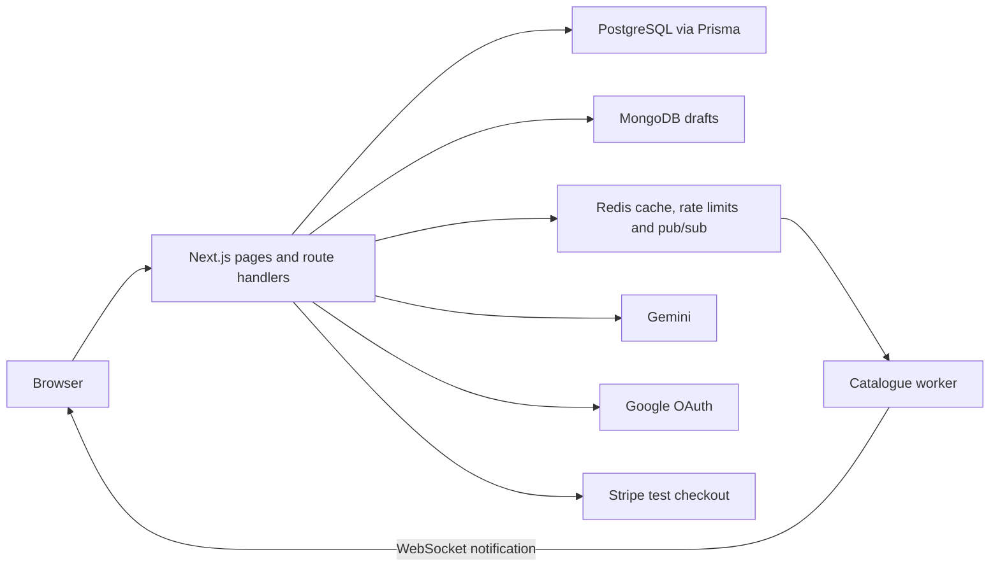

# CampusHub High-Level Design

CampusHub is a Next.js App Router application. It serves public pages, role-specific workspaces, and HTTP APIs from one application. The optional live catalogue worker runs as a separate process.

| Service | Responsibility |
|---|---|
| Next.js | Renders the public site and authenticated workspaces. Route handlers validate requests and enforce authorization. |
| PostgreSQL | Stores users, events, saved events, poster analysis, manager decisions, and test ticket orders. |
| MongoDB | Stores private drafts indexed by owner and update time. |
| Redis | Caches upcoming event listings, supports request quotas and embedding reuse, and carries catalogue notifications. |
| Catalogue worker | Forwards catalogue notifications to browsers. The client refetches the catalogue via HTTP. |
| Optional providers | Gemini handles poster extraction and event suggestions, Google handles identity verification, and Stripe handles test checkout. |

## Boundaries

Public catalogue queries select approved events. Session verification and role checks protect organizer and manager actions, and draft operations are scoped to the authenticated owner. Approval updates the event and records review history in one PostgreSQL transaction. Redis notifications prompt clients to refresh after the data changes.

Docker Compose starts the local backing services and offers a profile for checking the production build. Prisma migrations define the PostgreSQL schema. Runtime configuration and secrets are supplied separately for every environment.
